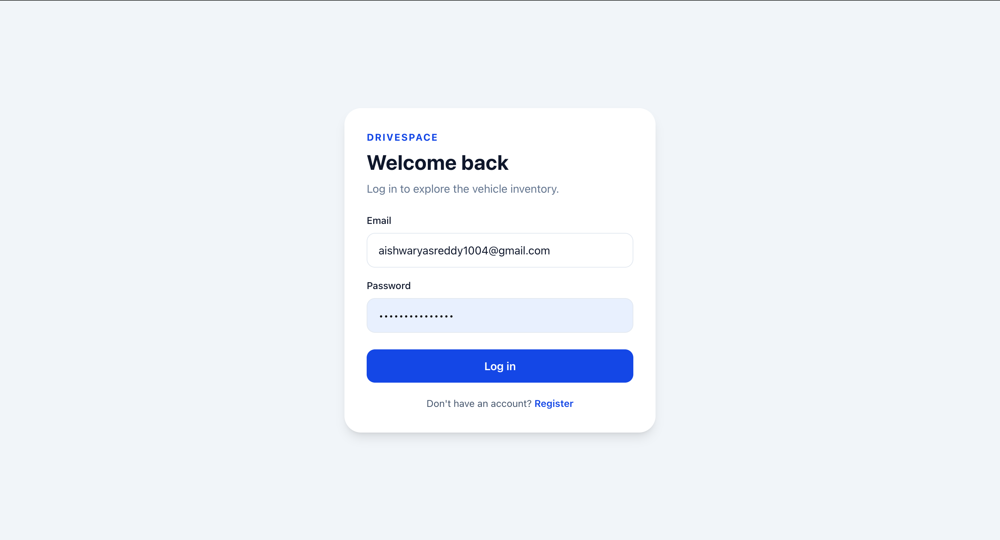
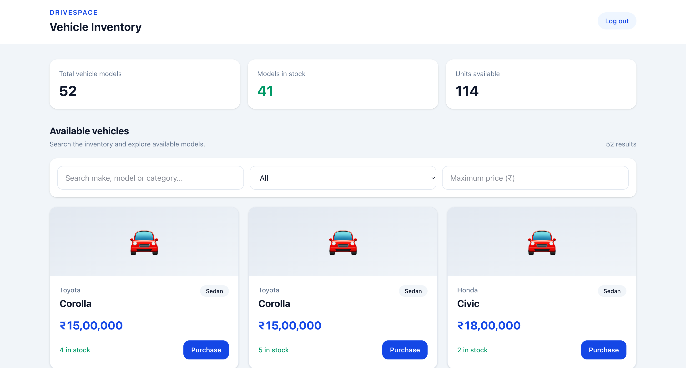
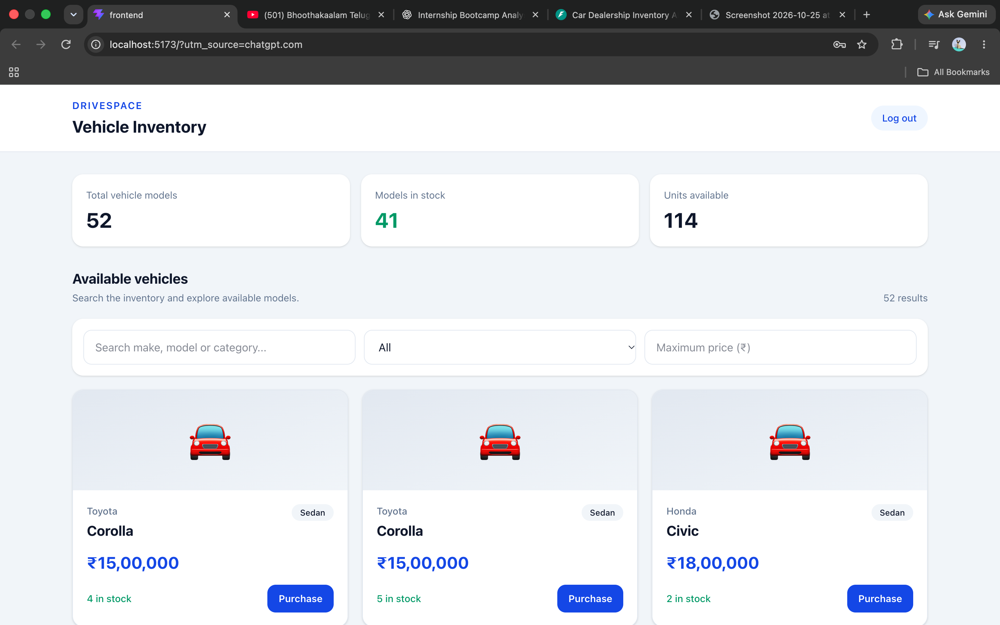
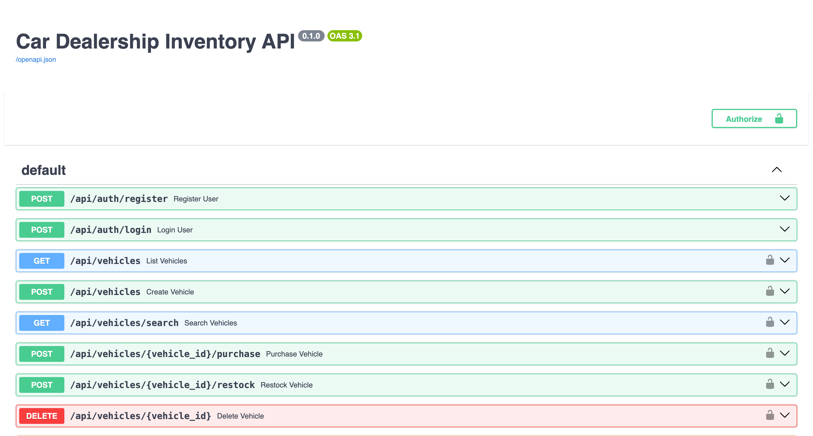

# DriveSpace — Car Dealership Inventory System

## About the Project

DriveSpace is a car dealership inventory management application that allows users to register, log in, browse available vehicles, search the inventory, and purchase vehicles. Stock is updated automatically after a successful purchase.

The system also provides administrator-only operations for adding vehicles, updating vehicle details, restocking inventory, and deleting vehicles.

The backend is built with FastAPI, SQLite, and SQLAlchemy. The frontend uses React, TypeScript, Vite, and Tailwind CSS. Pytest is used to test backend functionality.

## Technologies Used

- **Backend:** Python, FastAPI, SQLAlchemy
- **Database:** SQLite
- **Frontend:** React, TypeScript, Vite, Tailwind CSS
- **Authentication:** JWT-based authentication
- **Testing:** Pytest
- **Quality checks:** ESLint and production build verification

## Features

- User registration and login
- JWT authentication for protected endpoints
- Authenticated vehicle inventory access
- Search by make, model, category, and price range
- Vehicle purchases with automatic stock updates
- Prevention of purchases when a vehicle is out of stock
- Administrator-only vehicle creation, updates, restocking, and deletion
- Order creation and purchase history
- Automated backend API tests
- Interactive API documentation through FastAPI

## Screenshots

### Vehicle Inventory



### Vehicle Search



### Vehicle Purchase



### API Documentation



## Project Structure

```text
car-dealership-inventory-final/
├── backend/
│   ├── app/
│   ├── tests/
│   ├── .env.example
│   └── requirements.txt
├── frontend/
├── screenshots/
├── scripts/
│   └── verify.sh
├── PROMPTS.md
├── README.md
└── TEST_REPORT.md
```

## Prerequisites

Install Python 3, Node.js, and npm.

## How to Run the Project

### 1. Set Up the Backend

From the repository root:

```bash
python3 -m venv .venv
source .venv/bin/activate
pip install -r backend/requirements.txt
```

Set a private JWT secret for your local environment:

```bash
export JWT_SECRET_KEY="your-local-secret"
```

Replace the example value with a strong, private secret. Never commit your actual secret to Git.

### 2. Initialize the Database

From the repository root, run:

```bash
cd backend
python -m app.seed
```

The seed script is designed to be idempotent and includes sample vehicles, including a sold-out vehicle.

### 3. Start the Backend

From the `backend` directory:

```bash
uvicorn app.main:app --reload
```

The backend runs at:

`http://127.0.0.1:8000`

Interactive API documentation:

`http://127.0.0.1:8000/docs`

### 4. Create an Administrator Account

Register an account normally through the frontend or the registration API.

From a second terminal, go to the `backend` directory, activate the same virtual environment, and run the following command with the email address of the existing account:

```bash
ADMIN_EMAIL=admin@example.com python -m app.bootstrap_admin
```

Replace `admin@example.com` with the intended administrator's registered email. Sign out and sign back in to refresh the user's role.

Registration does not grant administrator privileges. Administrator promotion is performed through the server-side CLI helper.

### 5. Start the Frontend

Open a second terminal at the repository root:

```bash
cd frontend
npm ci
npm run dev
```

Open the local URL displayed by Vite in your terminal.

## Running Tests and Verification

From the repository root, activate the virtual environment and run the verification script:

```bash
bash scripts/verify.sh
```

The script runs the backend tests, frontend production build, and frontend lint checks.

### Latest Recorded Results

- **Backend tests:** 25 passed
- **Warnings:** 2 deprecation warnings
- **Frontend production build:** Passed
- **Frontend lint:** Passed

These results are from the local verification run. See `TEST_REPORT.md` for the recorded details. Rerun the verification script after making changes to confirm the results remain valid.

The backend tests use an isolated in-memory SQLite database so test operations do not modify the regular application database.

## API Endpoints

| Method | Endpoint | Purpose |
|---|---|---|
| POST | `/api/auth/register` | Register a user |
| POST | `/api/auth/login` | Log in |
| GET | `/api/auth/me` | Retrieve authenticated user details |
| GET | `/api/vehicles` | View vehicles |
| GET | `/api/vehicles/search` | Search vehicles |
| POST | `/api/vehicles` | Add a vehicle (admin only) |
| POST | `/api/vehicles/{vehicle_id}/purchase` | Purchase a vehicle |
| POST | `/api/vehicles/{vehicle_id}/restock` | Restock a vehicle (admin only) |
| PUT | `/api/vehicles/{vehicle_id}` | Update vehicle details (admin only) |
| DELETE | `/api/vehicles/{vehicle_id}` | Delete a vehicle (admin only) |

Protected endpoints require authentication, and administrative operations require administrator privileges.

## Database

The application uses SQLite to store user and vehicle information. SQLAlchemy manages database operations. The test suite uses a separate in-memory database to isolate test data from the application's regular database.

## My AI Usage

I used ChatGPT to help understand errors, troubleshoot the test setup, review parts of the implementation, and improve project documentation. I reviewed the suggestions and checked changes against the application by running tests and verification commands.

AI assistance helped me identify debugging issues and possible gaps. I also learned the importance of checking generated suggestions instead of relying on them without verification.

`PROMPTS.md` documents AI-assisted work and includes the original conversation link currently available to me, together with summaries of assistance received. These summaries are not verbatim transcripts. I will ensure that the original conversation records meet the assignment's documentation requirements before submission.

## TDD and Commit History

The original implementation predates some of the tests added during development. The current Git history does not establish a complete Red–Green–Refactor sequence, so it should not be presented as one.

Historical commits and timestamps must not be fabricated. Future development should use genuine test-first changes and document AI assistance according to the assignment's requirements.

## Test Report

See [`TEST_REPORT.md`](TEST_REPORT.md) for verification results and warnings.

## Repository

Source code, tests, documentation, and screenshots are maintained in this GitHub repository.